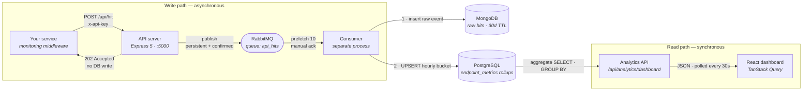

# API Monitoring System

A multi-tenant API observability platform. Your backend services report every API call
they serve — endpoint, method, status code, latency — and this system turns that stream
into dashboards: total hits, error rates, latency percentiles, and slowest endpoints,
scoped per customer.

The design constraint that shapes everything: **the ingest endpoint sits inside someone
else's request path.** If reporting a hit is slow, we've made their API slow. So ingest
does the minimum — authenticate, validate, publish to a queue, return `202` — and all
the expensive work happens in a separate consumer process.

---

## Contents

- [Architecture](#architecture)
- [Repository layout](#repository-layout)
- [Tech stack](#tech-stack)
- [Running locally](#running-locally)
- [Environment variables](#environment-variables)
- [First-run bootstrap](#first-run-bootstrap)
- [Integrating your service](#integrating-your-service)
- [API reference](#api-reference)
- [How the data is stored](#how-the-data-is-stored)
- [Reliability behaviour](#reliability-behaviour)
- [Deployment](#deployment)
- [Known gaps](#known-gaps)

---

## Architecture



The queue is the seam. Everything left of RabbitMQ is on a customer's critical path and
is optimised for latency; everything right of it is background work and is optimised for
durability. A dead consumer or a down database degrades *dashboard freshness*, not
*ingest availability*.

The trade-off this buys, stated plainly: **the dashboard is eventually consistent.** A hit
that returned `202` is not on the chart yet.

---

## Repository layout

```
.
├── server/                              # Backend — two processes, one codebase
│   ├── src/
│   │   ├── server.js                    # API entrypoint
│   │   ├── services/
│   │   │   ├── auth/                    # Login, registration, JWT issuance
│   │   │   ├── client/                  # Tenants, users, API keys
│   │   │   ├── ingest/                  # POST /api/hit — the hot path
│   │   │   ├── analytics/               # Dashboard reads
│   │   │   └── processor/               # Consumer entrypoint + write logic
│   │   └── shared/
│   │       ├── config/                  # mongodb · postgres · rabbitmq · logger
│   │       ├── events/producer/         # Confirm channel · circuit breaker · retry
│   │       ├── middlewares/             # authenticate · authorize · validateApiKey
│   │       ├── models/                  # Mongoose schemas
│   │       └── utils/                   # AppError · ResponseFormatter · SecurityUtils
│   ├── scripts/init-postgres.sql        # Rollup table, indexes, updated_at trigger
│   ├── docker-compose.yml               # Full local stack
│   ├── Dockerfile                       # API image
│   └── Dockerfile.consumer              # Consumer image
├── dashboard/                           # React 19 + Vite frontend
│   └── src/
│       ├── api/api.js                   # axios client (withCredentials)
│       ├── hooks/                       # TanStack Query hooks
│       ├── pages/                       # Overview · API management · Team · Settings
│       └── components/charts/           # ApexCharts wrappers
├── render.yaml                          # Blueprint for both backend services
└── DEPLOYMENT.md                        # Free-tier deployment walkthrough
```

Each service folder follows the same shape — `routes/` → `controller/` → `service(s)/` →
`repository/`, wired together by a small `Dependencies/` container. Every class takes its
collaborators as constructor arguments and throws at startup if one is missing, so a
wiring mistake fails immediately with a clear message rather than at runtime on a null
reference. It also means the failure logic can be unit-tested against fakes with no
RabbitMQ running.

---

## Tech stack

| Layer | Choice | Why this one |
|---|---|---|
| Runtime | Node.js 18 (ESM) | Ingest is pure I/O and zero CPU — one key lookup, one socket write. The event loop holds thousands of waiting connections cheaply. Aggregation is deliberately pushed into SQL rather than JavaScript. |
| API | Express 5 | Minimal, and the middleware chain maps cleanly onto the two auth schemes. |
| Broker | RabbitMQ | A *work queue* with per-message ack, per-message retry, and a dead-letter path — not a replayable log. Kafka's model would make the one poison message in a million block a partition. |
| Raw store | MongoDB | Schemaless raw events plus a TTL index that expires them at 30 days with no cron job. |
| Rollup store | PostgreSQL | `ON CONFLICT DO UPDATE` gives an atomic, concurrency-safe running aggregate. Relational aggregation is what the dashboard actually queries. |
| Frontend | React 19 · Vite · TanStack Query · ApexCharts | Query handles caching, dedup, and polling; SCSS modules keep styles scoped. |
| Auth | JWT in `httpOnly` cookie · `x-api-key` header | Two caller types, two schemes — see [API reference](#api-reference). |

---

## Running locally

The full stack — Postgres, MongoDB, RabbitMQ, pgAdmin, API, and consumer — runs from one
Compose file.

```bash
cd server
cp .env.sample .env    # then fill in MONGO_URI, MONGO_DB_NAME, JWT_SECRET
docker compose up --build
```

| Service | URL |
|---|---|
| API | http://localhost:5001 |
| Health check | http://localhost:5001/health |
| RabbitMQ management UI | http://localhost:15672 — `api_user` / `secure_password` |
| pgAdmin | http://localhost:8080 — `admin@example.com` / `admin` |
| Postgres | `localhost:5432` |
| MongoDB | `localhost:27017` |

The Postgres container runs `scripts/init-postgres.sql` automatically on first boot. A
managed Postgres (Neon, RDS) will not — run that file by hand once.

**Running the backend without Docker**, in two terminals:

```bash
cd server && npm install && npm run dev
```

```bash
cd server && node src/services/processor/consumer.js
```

**Frontend:**

```bash
cd dashboard && npm install && npm run dev
```

Vite serves on http://localhost:5173 and defaults to an API at `http://localhost:5001/api`.
Override with `VITE_API_BASE_URL` in `dashboard/.env`.

---

## Environment variables

Set these for **both** the API and the consumer:

| Variable | Default | Notes |
|---|---|---|
| `NODE_ENV` | `development` | Controls cookie `Secure` / `SameSite` behaviour. |
| `PORT` | `5000` | |
| `MONGO_URI` | — | Required. Atlas connection string or local URI. |
| `MONGO_DB_NAME` | `api_monitoring` | |
| `PG_HOST` | `localhost` | |
| `PG_PORT` | `5432` | |
| `PG_DATABASE` | `api_monitoring` | |
| `PG_USER` | `postgres` | |
| `PG_PASSWORD` | — | |
| `PG_SSL` | `false` | Set `true` for managed Postgres. |
| `RABBITMQ_URL` | `amqp://localhost:5672` | |
| `RABBITMQ_QUEUE` | `api_hits` | The DLQ is derived as `<queue>.dlq`. |
| `RABBITMQ_RETRY_ATTEMPTS` | `3` | |
| `RABBITMQ_RETRY_DELAY` | `1000` | Base delay in ms, before exponential growth. |

API server only:

| Variable | Default | Notes |
|---|---|---|
| `JWT_SECRET` | *(insecure fallback)* | **Always set this in production.** Generate with `openssl rand -base64 48`. |
| `JWT_EXPIRES_IN` | `24h` | |
| `CORS_ORIGIN` | `http://localhost:5173` | Must be one exact origin — `*` is rejected by browsers for credentialed requests. |
| `RATE_LIMIT_WINDOW_MS` | `900000` | 15 minutes. |
| `RATE_LIMIT_MAX_REQUESTS` | `1000` | Per IP, per window. |

---

## First-run bootstrap

There's a chicken-and-egg problem: you need an admin to create users, and something has to
create the first admin. The `onboard-super-admin` endpoint checks whether *any* user exists
and refuses if one does — so it works exactly once and is permanently closed afterwards.
There is deliberately no UI for it.

**1 · Create the super admin**

```bash
curl -X POST http://localhost:5001/api/auth/onboard-super-admin \
  -H "Content-Type: application/json" \
  -d '{"username":"atharv","email":"you@example.com","password":"Str0ng!Pass"}'
```

The JWT comes back as an `httpOnly` cookie. Add `-c cookies.txt` and then `-b cookies.txt`
on subsequent calls to reuse it from the terminal.

**2 · Onboard a tenant**

```bash
curl -X POST http://localhost:5001/api/admin/clients/onboard \
  -b cookies.txt -H "Content-Type: application/json" \
  -d '{"name":"Zomato Demo","email":"ops@zomato-demo.test"}'
```

Note the returned `_id` — that's your `clientId`.

**3 · Issue an API key for that tenant**

```bash
curl -X POST http://localhost:5001/api/admin/clients/<clientId>/api/keys \
  -b cookies.txt -H "Content-Type: application/json" \
  -d '{"name":"production","environment":"production"}'
```

The response contains a `keyValue` that looks like `apim_a1b2c3…`. This is what your
service puts in `MONITORING_API_KEY`. Keys expire after 365 days by default
(`API_KEY_EXPIRY_DAYS`).

You can also do steps 2 and 3 from the dashboard's **Team Management** page once logged in.

---

## Integrating your service

Any service that can make an HTTP POST can report hits. In Express, drop in a middleware
that times each request and fires the metrics off *after* the response is already on its
way to the user.

### The middleware

`monitoring.js` exports a **factory** — calling it with a config object returns the actual
Express middleware. It wraps `res.end`, times the request, and dispatches via
`setImmediate` so the reporting call never sits in the response path:

```javascript
const monitoringMiddleware = (options = {}) => {
    const {
        apiKey = process.env.MONITORING_API_KEY,
        endpoint = process.env.MONITORING_ENDPOINT || 'http://localhost:5001/api/hit',
        serviceName = process.env.SERVICE_NAME || 'my-service',
        enableLogging = process.env.NODE_ENV !== 'production',
        timeout = 3000,
        enabled = process.env.MONITORING_ENABLED !== 'false'
    } = options;

    // No key or explicitly disabled — become a no-op rather than throwing.
    if (!enabled || !apiKey) {
        if (enableLogging && !apiKey) console.warn('Monitoring middleware: API key not configured');
        return (req, res, next) => next();
    }

    return (req, res, next) => {
        const startTime = Date.now();
        const originalEnd = res.end;

        res.end = function (...args) {
            const responseTime = Date.now() - startTime;

            const monitoringData = {
                serviceName,
                endpoint: req.originalUrl || req.url,
                method: req.method,
                statusCode: res.statusCode,
                latencyMs: responseTime,
                ip: req.ip || req.connection?.remoteAddress || 'unknown',
                userAgent: req.get('User-Agent') || 'unknown'
            };

            setImmediate(() => sendMonitoringData(monitoringData, { apiKey, endpoint, enableLogging, timeout }));
            originalEnd.apply(res, args);
        };

        next();
    };
};
```

Three properties worth keeping if you reimplement this in another language:

- **Fail open.** A missing key returns a pass-through middleware. Monitoring must never
  be able to take down the thing it monitors.
- **Report after responding.** `setImmediate` defers the outbound call until the current
  response has been flushed.
- **Bound the call.** A `timeout` on the reporting request means a slow monitoring
  endpoint can't accumulate open sockets in your service.

### Wiring it up

Register it early — after the core Express middleware, before any routes — so every
route gets timed:

```javascript
const monitoringMiddleware = require('./monitoring');

app.use(cors());
app.use(express.json());

// Apply monitoring middleware early in the stack
app.use(monitoringMiddleware({
    serviceName: 'zomato-api',
    enableLogging: true
}));
```

Because it's a factory, `serviceName` and `enableLogging` are set inline per app;
everything else (`apiKey`, `endpoint`, `timeout`, `enabled`) falls back to `.env`:

```bash
MONITORING_API_KEY=apim_your_key_here
MONITORING_ENDPOINT=http://localhost:5001/api/hit
SERVICE_NAME=zomato-api
MONITORING_ENABLED=true
```

### Reporting a hit by hand

The middleware is a convenience. The wire format is just this:

```bash
curl -X POST http://localhost:5001/api/hit \
  -H "Content-Type: application/json" \
  -H "x-api-key: apim_your_key_here" \
  -d '{
    "serviceName": "zomato-api",
    "endpoint": "/api/restaurants",
    "method": "GET",
    "statusCode": 200,
    "latencyMs": 42.5
  }'
```

```json
{
  "success": true,
  "message": "API hit queued for processing",
  "data": {
    "eventId": "0f3c2b1a-8d4e-4c2f-9a71-5b6c7d8e9f01",
    "status": "queued",
    "timestamp": "2026-08-23T10:14:02.331Z"
  },
  "statusCode": 202,
  "timestamp": "2026-08-23T10:14:02.332Z"
}
```

You never send a `clientId` — it's resolved server-side from the API key and stamped onto
the event, so it can't be forged. `ip` and `userAgent` are taken from the request if you
omit them.

**`202`, not `200`,** because the work isn't done. It's queued, and it'll be processed by
a different process shortly. A caller that saw `200` would reasonably expect to read the
data back immediately.

---

## API reference

All responses are wrapped:
`{ success, message, data, statusCode, timestamp }` — errors carry `error` instead of `data`.

### Authentication

Two schemes, because there are two kinds of caller.

**Machines** — a backend reporting hits — send `x-api-key`. A server has nowhere to log in
and no session, and the key carries a `canIngest` permission so it can write telemetry but
cannot read anyone's analytics.

**Humans** get a JWT in an `httpOnly` cookie. `httpOnly` means no page JavaScript can read
the token, so an XSS bug can't exfiltrate it — the thing `localStorage` can't give you. In
production the cookie is `Secure` + `SameSite=None`, because the frontend and API are on
different hosts.

### Public

| Method | Path | Description |
|---|---|---|
| `GET` | `/health` | Liveness — status, uptime, timestamp. |
| `GET` | `/` | Service banner and endpoint index. |

### Auth — `/api/auth`

| Method | Path | Auth | Description |
|---|---|---|---|
| `POST` | `/onboard-super-admin` | none | One-time bootstrap. Refuses once any user exists. |
| `POST` | `/register` | cookie · `super_admin` | Create a user. |
| `POST` | `/login` | none | Sets the `authToken` cookie. |
| `GET` | `/profile` | cookie | Current user, password stripped. |
| `POST` | `/logout` | none | Clears the cookie. |

### Tenants and keys — `/api/admin`

All require a valid cookie. Key creation and deactivation additionally require
`super_admin` or `client_admin`, and a `client_admin` is confined to their own tenant.

| Method | Path | Description |
|---|---|---|
| `POST` | `/clients/onboard` | Create a tenant. Slug is derived from the name. |
| `POST` | `/clients/:clientId/users` | Add a `client_admin` or `client_viewer`. |
| `POST` | `/clients/:clientId/api/keys` | Issue a key. **The plaintext value is in this response.** |
| `GET` | `/clients/:clientId/api/keys` | List keys — `keyValue` is omitted. |
| `DELETE` | `/clients/:clientId/api/keys/:apiKeyId` | Deactivate a key. |

### Ingest — `/api/hit`

| Method | Path | Auth | Description |
|---|---|---|---|
| `POST` | `/` | `x-api-key` | Queue one API hit. |

| Field | Type | Required | Notes |
|---|---|---|---|
| `serviceName` | string | yes | Groups endpoints under one service. |
| `endpoint` | string | yes | Path as served, e.g. `/api/restaurants`. |
| `method` | string | yes | One of `GET POST PUT PATCH DELETE OPTIONS HEAD`. |
| `statusCode` | number | yes | 100–599. |
| `latencyMs` | number | yes | Non-negative. |
| `ip` | string | no | Falls back to the request IP. |
| `userAgent` | string | no | Falls back to the request header. |

| Status | Meaning |
|---|---|
| `202` | Queued. |
| `400` | Validation failed — missing field, bad method, out-of-range status or latency. |
| `401` | No `x-api-key`. |
| `403` | Key invalid, expired, lacking `canIngest`, or client inactive. |
| `429` | Rate limit — 1000 requests per 15 minutes per IP by default. |
| `503` | Circuit breaker open; the body carries a `retryAfter` hint. |

### Analytics — `/api/analytics`

Cookie auth. Results are scoped to the caller's `clientId`; a `super_admin` sees all
tenants and may narrow with `?clientId=`.

| Method | Path | Query | Description |
|---|---|---|---|
| `GET` | `/stats` | `startTime` · `endTime` · `clientId` | Totals, error rate, average latency, unique services and endpoints. |
| `GET` | `/dashboard` | same | Stats, top 5 endpoints, and recent time series in one call. |

Time filters accept an ISO 8601 string or an epoch millisecond value, and default to the
last 24 hours. The dashboard endpoint runs its three queries with `Promise.allSettled`, so
one failing panel returns `null` rather than 500-ing the whole page.

---

## How the data is stored

Two stores, because there are two different questions.

**MongoDB — `api_hits`** holds the raw event: one document per API call, with compound
indexes for the common drill-downs and a TTL index that expires documents after 30 days.
This is the audit trail. `eventId` carries a unique index, which is the real defence
against double-counting a redelivered message.

**PostgreSQL — `endpoint_metrics`** holds the *answer*. Scanning a million raw documents on
every dashboard load doesn't scale, so the consumer folds each event into an hourly bucket
at write time, keyed by:

```
UNIQUE (client_id, service_name, endpoint, method, time_bucket)
```

The dashboard then reads at most 24 pre-aggregated rows. The framing: **the cost moves from
read time to write time.** Writes happen once per event in the background; reads happen
every 30 seconds per open dashboard.

That composite constraint is what makes the upsert possible. Hits and errors add; min and
max use `LEAST` / `GREATEST`; the average is a running weighted mean, because you cannot
average an average:

```
new_avg = (old_avg × old_hits + incoming_avg × incoming_hits)
          ÷ (old_hits + incoming_hits)
```

Postgres serialises concurrent upserts to the same row, so two consumer replicas writing
the same bucket in the same instant can't lose an increment the way a read-modify-write in
application code would.

**Write ordering is deliberate.** MongoDB first — if it fails, the error propagates and the
message is retried. PostgreSQL second — if *it* fails, the error is logged and swallowed,
because the raw event is already safe and the rollup can be rebuilt from it. Failing the
whole message at that point would risk duplicating the raw write for no gain.

---

## Reliability behaviour

Three distinct mechanisms guard the queue, protecting against three different failures.

**Producer side.** Messages go out on a **confirm channel** with `persistent: true`, so the
broker acknowledges that the message is on disk before ingest reports success — a plain
`publish()` only tells you the bytes reached a socket buffer. A failed publish is retried
with **exponential backoff plus ±30% jitter**; the jitter matters because a thousand
publishes that all fail at the same instant and all back off exactly 200 ms would retry in
a synchronised stampede that re-kills the broker the moment it recovers. Behind the retry
loop, a **circuit breaker** converts a sustained outage into an instant `503` instead of
burning three retries and 15 seconds per request. After the cooldown it goes `HALF_OPEN`
and lets exactly three probes through — all must pass to close it, and one failure reopens.

**Consumer side.** `prefetch(10)` caps unacked messages so the broker can't push the whole
queue into Node's memory, and it makes work distribute fairly across replicas.
Acknowledgement is manual, which means at-*least*-once delivery — a crash mid-write
redelivers rather than silently dropping. On a processing failure, retryable errors are
re-published with an incremented `x-retry-count` header; the count lives in the message,
not in consumer memory, so it survives a restart. Anything non-retryable or past three
attempts goes to **`api_hits.dlq`** with `x-dlq-reason` and `x-dlq-error` attached — a queue
you inspect to find the bug, not a bin.

| Tunable | Value | Set by |
|---|---|---|
| Failures before the circuit opens | 5 | code |
| Circuit cooldown | 30 s | code |
| Half-open probes (all must pass) | 3 | code |
| Publish / consume retry attempts | 3 | `RABBITMQ_RETRY_ATTEMPTS` |
| Backoff base → cap | 200 ms → 5 s (producer), 30 s (consumer) | `RABBITMQ_RETRY_DELAY` |
| Backoff jitter | ±30% | code |
| Consumer prefetch | 10 | code |
| Rollup bucket | 1 hour | code |
| Raw event retention | 30 days | Mongo TTL index |
| Dashboard poll interval | 30 s | `dashboard/src/constants/index.js` |

**Graceful shutdown.** On `SIGTERM` the API stops accepting connections, drains in-flight
requests, then closes Mongo, Postgres, and RabbitMQ — with a 10-second forced-exit timer so
a hung connection can't block a rolling deploy.

---

## Deployment

[`DEPLOYMENT.md`](DEPLOYMENT.md) walks through a free-tier deployment across five services:
MongoDB Atlas, Neon (Postgres), CloudAMQP (RabbitMQ), Render (API + consumer via
[`render.yaml`](render.yaml)), and Vercel (dashboard).

Two things that bite:

- Managed Postgres won't run `init-postgres.sql` for you. Run it once by hand.
- `CORS_ORIGIN` must be the exact frontend origin, no trailing slash. The credentialed
  cookie means the browser rejects `*`, and getting this wrong is the difference between a
  working login and a silent 401 loop.

